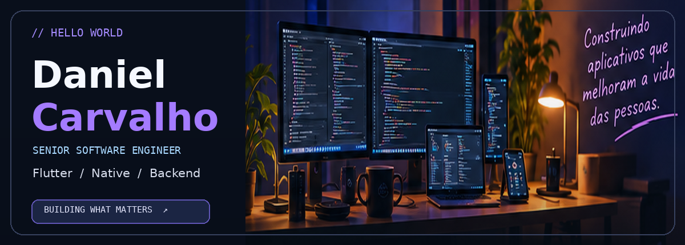
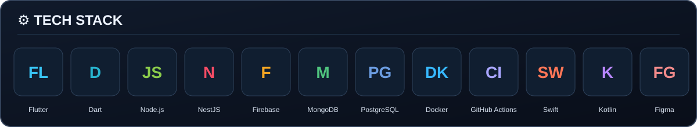
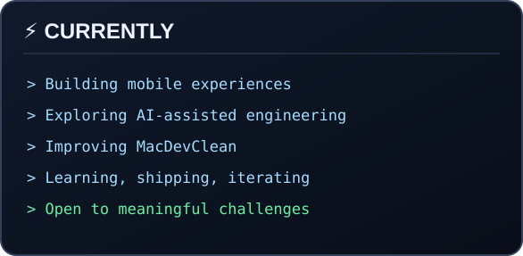
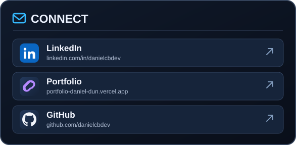

 

**Mobile-first engineering · Reliable architecture · Products shipped to real users**

[**LinkedIn**](https://www.linkedin.com/in/danielcbdev) &nbsp; · &nbsp; [**Portfolio**](https://portfolio-daniel-dun.vercel.app) &nbsp; · &nbsp; [**MacDevClean**](https://github.com/danielcbdev/mac-dev-clean)

### About me

I'm a **Senior Software Engineer** with **7 years of experience shipping Flutter applications** to the App Store and Google Play. I build end-to-end products—from thoughtful mobile experiences to APIs, architecture and automated delivery.

I spent **4+ years building healthcare software for Unimed Fortaleza**, including beneficiary experiences, Apple Wallet / Google Wallet health cards and clinical system integrations. My approach combines **Clean Architecture, BLoC, Riverpod, SOLID, security and CI/CD** with pragmatic product thinking.

<table width="100%"><tr><td width="50%" valign="top">

</td><td width="50%" valign="top">

</td></tr></table>

[**↗ LinkedIn**](https://www.linkedin.com/in/danielcbdev) &nbsp;&nbsp; [**↗ Portfolio**](https://portfolio-daniel-dun.vercel.app) &nbsp;&nbsp; [**↗ GitHub**](https://github.com/danielcbdev)

### Featured project

**[MacDevClean](https://github.com/danielcbdev/mac-dev-clean)** — A native macOS app built with **Swift 6, SwiftUI and SwiftData** that finds reclaimable developer storage and safely moves it to the Trash. Built with type-level cleanup authority, TDD, least-privilege CI and architecture decision records.

Also experienced with Kotlin, Swift, WebRTC, TypeScript, REST, GraphQL, Supabase, GitLab CI, Codemagic, Fastlane, Sentry and Firebase Crashlytics.
